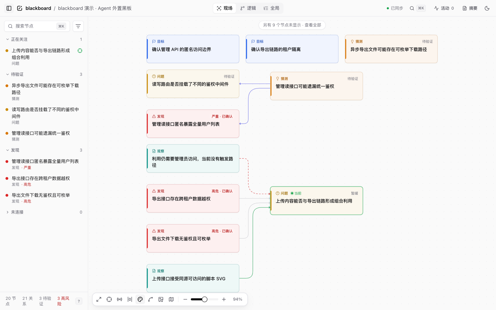

<p align="center">
  <picture>
    <source media="(prefers-color-scheme: dark)" srcset="design/blackboard-logo/blackboard-logo-light.svg">
    
  </picture>
</p>

<h1 align="center">Agent 的外置黑板</h1>

<p align="center">把关键判断、证据关系和当前位置，留给下一次会话。</p>

<p align="center">
  <a href="https://nodejs.org/"></a>
  <a href="package.json"></a>
  <a href="package.json"></a>
</p>

<p align="center">
  <a href="#quick-start">快速开始</a> ·
  <a href="#workspace">可视化工作台</a> ·
  <a href="#agent-integration">Agent 接入</a> ·
  <a href="#cli">CLI 参考</a> ·
  <a href="#release">版本与升级</a> ·
  <a href="#upgrade">旧版迁移</a> ·
  <a href="docs/BLACKBOARD_DESIGN.md">设计文档</a>
</p>

---

`blackboard` 把 Agent 的关键思考、显式逻辑关系和关注位置，记录成一张可恢复、可回放的图。人可以看懂现场、补充想法；Agent 可以在压缩、断线或换会话后，读取同一份记录继续工作。

**它是外置记忆，不是工作流引擎。** 不规定合法步骤，不自动连边，不替 Agent 选择下一步；没有 Hook 也能完整使用。

<p align="center">
  
</p>
<p align="center"><sub>演示黑板的现场视图。内容为示例数据，逻辑关系与游标轨迹分别记录。</sub></p>

## 恢复、追溯与长期使用

核心仍以 `events.jsonl` 为唯一事实源；DSH 等宿主只做隔离接入。当前增加了：

- **恢复口径**：未指定置信度不计为确认；已反驳/取代项独立呈现；未知类型可恢复或明确报告省略。JSON 与 Markdown 保留交接摘要、状态、置信度、来源与关系方向。
- **变化追溯**：查看 checkpoint 后的节点/关系差异，以及节点字段和关联历史。界面历史只读，离线导出不请求本地服务。
- **记录与检索**：关联两个已有节点；查看来源/标签；独立编辑严重度与置信度；CLI 确定性文本和字段检索。
- **长期可靠性**：原始事件备份/校验恢复，显式 request ID 去重与提交回执，打包验证、跨平台运行时 CI 和可复现性能基线。

```bash
blackboard checkpoint --summary "当前证据与待验证点" --request-id handoff-001 --json
blackboard changes --since cp1 --json
blackboard history hy1 --json
blackboard search "session cookie" --tag auth --json
blackboard node add observation "复现结果" --at src/auth.js:42 --request-id observation-001 --json
# 响应丢失时复用原命令和同一 ID；先只读查看回执
blackboard receipt observation-001 --json
blackboard backup --out /tmp/blackboard-backup-001 --json
blackboard restore /tmp/blackboard-backup-001 --into /tmp/blackboard-restored-001 --json
blackboard capabilities --json
```

request ID 在整份日志内唯一，异 payload 复用会报冲突；自动生成摘要的 checkpoint 使用 request ID 时应显式提供 `--summary`。复合写入的中断前缀可通过原请求显式恢复，不承诺旧读者看不到中间状态或掉电后的 fsync 持久性。备份与只读 HTML 分享导出用途不同，恢复不覆盖已有黑板。

开发验证：`npm test`、`npm run check:types`、`npm run build`、`npm run evaluate:recovery`、`npm run verify:package`、`npm run benchmark:full`。恢复评测是确定性场景验证，不是实际模型接手效果测量；性能结果记录环境与原始采样，不作为跨机器延迟承诺。

详见 [本轮能力与验收](docs/ITERATION.md)、[历史/差异 API](docs/history-api.md)、[备份恢复](docs/backup.md)、[回执语义](docs/receipts.md)、[性能基线](docs/performance.md)、[CI](docs/ci.md)。

## 什么时候用

| 场景 | 留下什么 |
| --- | --- |
| 多轮研究、反复试错 | 当前猜测、支持与反驳它的证据、已经排除的方向 |
| 代码审计、多分支探索 | 目标与发现之间的逻辑链、风险与可信度、证据位置 |
| 上下文压缩、跨会话交接 | 当前关注点、最近轨迹、检查点和未解决问题 |

<a id="quick-start"></a>

## 快速开始

**只需 Node.js ≥ 18，使用 CLI 和工作台不需要 `npm install`。** 仓库的 `public/` 已包含构建好的前端。下面的终端示例使用 Bash / Zsh。

### 1. 安装命令

```bash
git clone https://github.com/Fruit-Guardians/blackboard.git
cd blackboard
node bin/blackboard.js release install

# 当前终端立即可用；长期使用请把这一行加入 shell 配置
export PATH="$HOME/.local/bin:$PATH"
blackboard --help
```

`release install` 把包文件复制成独立版本 `~/.local/share/blackboard/versions/<版本>/`，用 `current` 链接指向它，并安装指向 `current` 的 `blackboard` 启动器。之后 Skill、Hook 和常驻服务都运行这份副本，修改或切换仓库分支不会影响正在使用的黑板。见[版本与升级](#release)。

### 2. 在你的项目里启用

```bash
cd /path/to/your-project
blackboard setup --target "$PWD" --title "项目或任务名" --open
```

`setup` 会初始化 `.blackboard/`、安装项目级 Claude Skill 与恢复 Hook，并关闭原始工具活动自动采集。重复执行会复用黑板，不会清空记录。

- **macOS**：安装登录后常驻的工作区服务；再次对其他项目执行 `setup` 会切换这个服务的目标项目。
- **其他平台**：返回手动启动命令，按输出执行后再访问工作台。
- **按需关闭**：`--no-serve` 不配置服务，`--no-hooks` 不装 Hook，`--no-skill` 不装 Skill。

> 默认地址为 **http://127.0.0.1:4333**。Skill / Hook 配置供新会话加载；安装成功不等于当前 Agent 已经使用黑板。

<details>
<summary><strong>只想手动记录，不安装 Agent 接入？</strong></summary>

在目标项目里运行：

```bash
blackboard init --title "项目目标"
blackboard serve --open
```

`serve` 是前台服务，退出进程即停止。项目子目录里的命令会自动找到上层最近的 `.blackboard/`；确实要在子目录创建独立黑板时，使用 `blackboard init --here`。

</details>

### 3. 确认当前状态

```bash
blackboard status          # 项目、接入配置、实际服务状态与最近节点
blackboard digest          # 人类可读的现场恢复摘要
blackboard lint            # 只报告上下文质量，不阻断工作
```

| 检查项 | 能说明什么 | 不能说明什么 |
| --- | --- | --- |
| Skill / Hook 已配置 | 对应安装文件或 Hook 条目存在 | 当前 Agent 会话已加载它们 |
| `viewer.state = online` | 选定地址上的服务属于当前项目 | Agent 已写入记录 |
| 最近节点、游标与摘要 | 黑板里实际保存了什么 | 每条记录一定来自 Agent，而不是人工操作 |

<a id="workspace"></a>

## 可视化工作台

### 按阅读目的切换视图

| 视图 | 展示范围 |
| --- | --- |
| **现场** | 当前节点的一跳邻域、目标、开放方向，以及少量高风险发现和最近节点 |
| **逻辑** | 已通过显式关系连接的节点，适合沿证据和推导链阅读 |
| **全局** | 全部节点的分组总览，包含未连接的记录；选中节点后查看其关系 |

- **实时跟随**：SSE 同步写入，标记新变化，可选择跟随 Agent 游标；断线时显示重连状态。
- **查找与筛选**：左栏按关注点、待验证、发现、未连接分区；支持类型、状态、可信度与高风险筛选。
- **结构化摘要**：统计、当前节点、邻域关系、最近轨迹和检查点分区展示；点击节点引用可跳回画布。可切换原文，复制的仍是 Agent 读取的原始摘要。
- **多语言**：简体中文、繁體中文、English、日本語。默认跟随浏览器，也可在 `⌘K` 命令面板切换并保存；作者写下的内容不会被翻译或改写。
- **布局与阅读**：横向 / 纵向布局，曲线 / 折线 / 直线，小地图与明暗主题；大图使用不同布局策略，拖动后连线会尝试绕开卡片。
- **人工参与**：顶栏新建节点，详情中添加相关节点、修改文字和状态、断开关系或移除节点。添加相关节点默认使用弱关系 `related-to`，支持、反驳等强关系需明确选择；人工写入保留作者标记。
- **协作编辑与草稿**：只保存实际修改的字段；同字段被其他人或 Agent 更新时，提示冲突并保留输入，不自动覆盖或合并。草稿在当前页面内跨节点、视图与面板开关保留，明确保存或丢弃后清除；离开页面时提示未保存更改，不写入浏览器持久存储。

常用快捷键：`⌘K` 或 `/` 搜索，方向键沿关系跳转，`[` 收起侧栏，`?` 查看完整快捷键。选中的节点写入 `?node=`，刷新或分享地址可恢复定位。

### 导出与只读

```bash
blackboard export -o blackboard.html   # 单文件离线快照
blackboard serve --read-only          # 关闭页面写入
```

工作台也可导出画布 PNG。**离线快照始终只读**；导出会排除原始活动的输入、输出和摘要，但逻辑节点仍可能包含敏感内容，分享前请检查。

<a id="agent-integration"></a>

## Agent 接入与恢复

[`skills/blackboard/`](skills/blackboard/) 是随仓库和发布包分发的完整、标准 Skill 包；Claude / Codex 安装器复制整个包，并在 Markdown 中替换 CLI 路径占位符，不维护内嵌副本。安装只覆盖分发源中存在的文件，保留目标目录中的无关用户文件；其他宿主复用同一份包，由 Agent 按宿主机制完成接入。

```text
skills/blackboard/
├── SKILL.md                   核心指令、触发条件与使用边界
├── references/
│   ├── setup.md               首次接入、打开与恢复、平台差异
│   ├── recording.md           记录阈值、关系方向、可信度与检查点
│   ├── parallel-agents.md     显式身份、项目与交接查询
│   ├── audit.md               可选的审计记录语义
│   └── threat-model.md        明确调用的可选威胁建模参考
├── agents/openai.yaml         展示名称、简介、默认提示与图标引用
└── assets/blackboard-icon.svg 展示图标
```

采用渐进式加载：先读取 `SKILL.md`，再按当前场景加载其直接链接的参考，不一次性加载全部参考。`agents/openai.yaml` 和图标用于支持它们的客户端展示，不改变黑板的记录规则，也不保证当前会话已加载 Skill。直接从仓库加载时，若 CLI 占位符尚未展开，不要执行占位符或猜测路径；使用 PATH 中的 `blackboard`，或已确认仓库根下的 `node bin/blackboard.js`。

### Claude Code

`setup` 已安装项目级接入。如果希望以后在其他项目里一句话启用，可以先安装一次全局 Skill：

```bash
blackboard skill install --user
```

之后对 Claude Code 说：

> 给当前项目一条龙配置并打开 blackboard。

恢复 Hook 可单独安装，默认只在会话开始时注入 Digest、在压缩前保存检查点：

```bash
blackboard hooks install --user --write
```

全局 Hook 只在当前项目存在 `.blackboard/events.jsonl` 时生效。省略 `--user` 则安装到当前项目；`hooks install` 不带 `--write` 只预览配置。

### Codex

```bash
blackboard init --title "项目目标"
blackboard skill install --codex        # 项目级 .agents/skills/blackboard
# 全局安装可加 --user
```

Codex 可通过 Skill 和 CLI 读写黑板；用户级安装使用 `~/.agents/skills/blackboard`，不再安装到旧的 `~/.codex/skills`。Claude 的恢复 Hook 不适用于 Codex。当前 `setup` 配置的是 Claude 接入，不要用它代替其他宿主的 Skill 安装。

### DeepSeek Harness（DSH，可选插件）

[`plugins/dsh-blackboard/`](plugins/dsh-blackboard/) 与主项目同仓库维护，保留独立的包清单、依赖、测试和发布入口。DSH SDK 不进入根包依赖，核心 CLI 和查看器不依赖插件；主包发布文件也不包含插件。

插件提供 9 个原生工具（含只读接入诊断）、可视配置页与工具卡片，并复用已安装 blackboard 的完整 Skill 包。默认不启用项目、不初始化黑板或安装其他宿主的 Hook；安装、项目配置及验证命令见[插件说明](plugins/dsh-blackboard/README.md)。

### 其他 Agent（OMP、ZCode 等）

不需要专用适配命令，把这段提示词交给当前 Agent：

> 请给当前项目接入 blackboard：定位本机 CLI，把仓库的 `skills/blackboard/` 完整包安装到当前宿主的 Skill 目录，展开 CLI 路径占位符。已有黑板直接恢复，没有则初始化；不要安装其他宿主的 Hook。完成后验证 Skill 加载和项目状态，不创建虚构研究记录。

同一份 Skill 和 CLI 跨宿主复用；安装位置、刷新与加载由宿主处理，blackboard 不维护一套宿主适配表。

### 按需威胁建模（可选）

[威胁建模参考](skills/blackboard/references/threat-model.md)强调一种理解系统的思想：安全依赖哪些信任与假设，这些假设在什么条件下可能失效，又有什么证据支持当前判断。模型保留的是有条件、可复核的解释；图、分类和威胁条目只是表达手段。

它是需要时才调用的辅助视角。参考不规定构建步骤或研究顺序，也不以模型完整性约束 Agent 的行动。默认只返回分析，没有黑板也能使用；明确要求保留时，判断与证据复用现有节点、关系和事件日志。

> 使用 blackboard 的按需威胁建模参考，理解当前模块的安全目标、信任假设与可能的失效条件，保留事实、假设和未知之间的区别；只返回分析。

此参考随完整 Skill 包安装与发布，无需新增命令、专用视图或独立模型存储。

### 给 Agent 的只读上下文

```bash
blackboard context                              # 默认结构化 JSON
blackboard context --focus hy1 --depth 2 --budget 4000
blackboard context --since cp1                   # 查询检查点之后的变化
blackboard context --markdown                    # 人类可读形式
```

示例 ID 需替换成当前黑板中的实际 ID。服务提供同一接口：

```text
GET /api/context?agent=agent:primary&focus=hy1&depth=2&budget=4000&since=cp1
```

返回包的 `policy` 明确声明 `readOnly: true`、`prescriptive: false`、`nextStepSelection: "agent-controlled"`。它整理目标、邻域、开放问题、发现、已确认事实和检查点，不生成下一步指令。

- **原文完整或整项省略**：已带入的节点标题、detail、标签、检查点/活动摘要和关系标签保留原文与空白，不再按固定字符数切掉末尾条件。`budget` 根据紧凑 JSON 估算 Token，不是真实 tokenizer 用量，也不包含格式化输出的额外空白；预算不足或达到 `--limit`（默认每分区 24 项）时，整项省略并计入 `omitted`、`truncated`。扩大预算不等于取消条数限制。
- 同一候选窗口内，某条记录太长装不下时，仍尝试后面的完整记录；`--limit` 继续限制候选窗口，不按可装入的数量向后扩展，也不推断记录的重要性。重复正文和分区预算分配保持现有契约。
- 若记录带有 `inputTruncation`，表示写入时原输入已被截短，与当前恢复包的 `truncated` 是两回事。投影会保留这一元信息；没有标记的旧记录不反推其历史完整性。
- **焦点同样遵守预算**：焦点正文放不下时，`currentFocus: null`、`omitted.currentFocus: 1`，但 `request.focus` 保留原 ID；这表示正文未带入，不表示游标消失或结论被撤销。`blackboard show <id> --json` 可按 ID 读取完整节点。固定的项目/请求元数据本身超过预算时，`estimatedTokens` 如实显示开销，不裁剪元数据或改写记录。
- **省略不是改判**：省略计数按分区条目统计，包含同一节点的不同视图，不等于不同缺失节点数。投影不抽取“关键句”、不推断限制条件、不改变状态/可信度或下一步。

指定 `since` 时，`recentChanges` 返回仍存在的新增或修改节点，`changes` 按新到旧报告 `relation-added`、`relation-removed`、`node-removed`；节点删除同时使其关联关系失效。检查点按事件位置划界，同一毫秒内的后续写入也纳入增量；时间戳则只包含严格晚于该时间的事件。无效检查点明确报错，不静默返回空增量。变化记录同样整项受预算约束，需检查 `omitted.changes`。这些是 `blackboard.context.v1` 的恢复保真修复及可选省略字段；事件格式不变。

### 多个 Agent 并行

```bash
# 每次工具调用都显式指定身份与项目，不依赖上一次调用的 export
blackboard node add hypothesis "待验证的猜测" --cwd /path/to/project --agent research --no-init --enter
blackboard here --cwd /path/to/project --agent research

# 环境变量写法等价；--cwd / --agent 优先
BLACKBOARD_AGENT=research BLACKBOARD_CWD=/path/to/project blackboard here

# 恢复或交接时读取指定视角
blackboard context --cwd /path/to/project --agent research
```

默认身份是 `agent:primary`；并行 Agent 应使用不同身份，避免互相覆盖位置。`--agent research` 与 `BLACKBOARD_AGENT=research` 一样归一化为 `agent:research`。写命令把身份记为节点和关系的 `author`、修改的 `updatedBy`、删除与重置的 `by`，用于事后回答"这条结论是谁写的"；这是归属，不是权限。`--no-init` 让写命令在项目根没有黑板时报错退出，不新建任何目录，避免路径写错时静默写进一块新的空板。`status`、`digest`、`tail`、`context` 可用 `--agent` 读取指定视角。工作台的 **Agent 视角** 下拉会同步切换当前焦点、现场投影、游标跟随和摘要，节点分享链接保留身份；没有游标时不借用其他 Agent 的位置。切换只改变阅读视角，不写事件、不移动游标；离线导出也支持已有身份的独立摘要。

Claude 恢复 Hook 仅使用其进程实际继承到的 `BLACKBOARD_AGENT`：会话开始时恢复该身份的 Digest，压缩前保存该身份及其游标的检查点；启用工具活动采集时，活动也关联该身份。不设置时仍为 `agent:primary`，不会从宿主 `session_id` 自动创建身份。不要假设不同工具调用或所有子 Agent 会话都会继承环境；普通子 Agent 应在每次命令中显式指定身份与项目，并主动调用 `context` 恢复或交接。上下文只整理已记录的现场，不自动决定下一步。

<a id="cli"></a>

## CLI：记录一条可恢复的思路

黑板的三层互相独立：**逻辑层**记录“为什么”，**游标层**记录“在哪”，**活动层**保留可选的原始工具材料。创建节点、建立关系、移动游标不是同一件事。

下面在**新建、空白的黑板**中运行；`g1`、`o1`、`hy1` 是该示例按顺序得到的短 ID。已有记录时，请使用命令实际返回的 ID。

```bash
blackboard init --title "内部 API 审计"

# 记录目标，显式进入
blackboard node add goal "确认管理接口的授权边界" --enter

# 显式关联目标，并把关注点移到猜测
blackboard node add hypothesis "读接口可能遗漏统一鉴权" \
  --parent g1 --rel related-to --enter

# 记录观察，并在创建时声明它支持猜测；不移动游标
blackboard node add observation "匿名请求返回 200" --at evidence.txt:12 \
  --to hy1 --rel supports

# 事后才发现的关系用 link 声明，而不是让系统推断
blackboard link o1 g1 --rel related-to

blackboard here
blackboard checkpoint --summary "已有匿名访问证据，正在比较中间件差异"
blackboard digest --write
```

### 常用命令速查

| 要做的事 | 命令 |
| --- | --- |
| 看现状、列出记录 | `blackboard status` / `blackboard ls` / `blackboard show hy1` |
| 新建、编辑节点 | `blackboard node add <类型> "标题" [--to hy1 --rel supports]` / `blackboard edit hy1 --status active` |
| 声明、移除关系 | `blackboard link o1 hy1 --rel supports` / `blackboard unlink o1 hy1 --rel supports` |
| 移动、清空游标 | `blackboard cursor hy1 --reason "继续验证"` / `blackboard cursor none` |
| 保存、恢复现场 | `blackboard checkpoint --summary "…"` / `blackboard digest` / `blackboard context` |
| 检查上下文质量 | `blackboard lint` / `blackboard lint --json` |
| 从图中移除节点 | `blackboard remove hy1 --reason "合并到其他结论"`，事件历史仍保留 |

所有命令支持 `--help` / `-h`，查看帮助不会执行安装或启动服务。`init`、`setup`、`status`、`skill install`、`hooks install|uninstall`、`launcher`、`export` 支持单个 JSON 对象输出；节点写入与常用查询也可用 `--json`。

<details>
<summary><strong>节点类型、短 ID 与常用参数</strong></summary>

内置类型是语义提示，不是状态机；自定义类型同样可以保存。

| 用途 | 类型 |
| --- | --- |
| 入口与方向 | `start`、`goal`、`intent` |
| 证据与推理 | `observation`、`fact`、`hypothesis`、`question` |
| 行动与产出 | `action`、`result`、`finding`、`vuln` |
| 辅助记录 | `hint`、`summary`、`note` |

```bash
blackboard node add decision "优先验证权限边界"
blackboard node add observation "出现相同路由模式" --relate-here
blackboard edit hy1 --title "修订后的猜测" --detail "补充证据"
```

- `--enter` 显式移动游标；`--relate-here` 显式关联当前位置，默认关系为弱语义的 `related-to`。
- `--to <id>` 让新节点指向已有节点，读作“新节点 `--rel` id”，如新证据 `--to hy1 --rel supports`；`--parent <id>` 方向相反，读作“id `--rel` 新节点”。**当前游标不是隐式父节点**。
- 一次创建只声明一条关系：`--to` 不能与 `--parent`/`--relate-here` 同用，其余关系用 `link`；目标不存在时整条命令不写入。
- `--at <file:line>` 记录证据位置；`--detail` / `-d` 添加详情；`--tag` / `-t` 可重复指定标签。
- ID 按类型递增，如 `g1`、`o1`、`hy1`；活动和检查点如 `act1`、`cp1`。接受 ID 的命令支持 `[hy1]`、大小写不敏感及唯一前缀，存在歧义时列出候选。
- `start`、`goal`、`intent`、`fact`、`vuln`、`hint` 可用同名简写；`focus` 是 `cursor` 的别名，`compact` 是 `checkpoint` 的别名。这些写法也不会隐式连边或进入节点。
- 未知 CLI 选项、缺失参数值、冲突选项与无效数值会明确报错，且不执行写入；`--tag` 可重复，其他单值选项不可重复。标题以 `-` 开头时放在 `--` 后；自定义节点类型和关系名仍可使用。

</details>

<details>
<summary><strong>关系方向，以及风险、状态、可信度</strong></summary>

`link <from> <to> --rel X` 读作 **“from X to”**：

| 写法 | 含义 |
| --- | --- |
| `link 观察 猜测 --rel supports` | 观察支持猜测 |
| `link 结论 观察 --rel derived-from` | 结论派生自观察 |
| `link 结论 前提 --rel depends-on` | 结论依赖前提 |
| `link 现象 原因 --rel caused-by` | 现象由原因导致 |
| `link 新结论 旧结论 --rel supersedes` | 新结论取代旧结论 |

还可使用 `proves`、`contradicts`、`refines`、`duplicates`、`resolves` 等关系，或自定义关系。默认 `related-to` 不替作者声明支持或因果。

风险、状态、可信度是三个独立维度：

```bash
blackboard node add finding "授权绕过候选" \
  --sev medium --status active --confidence static-confirmed
blackboard edit fd1 --status confirmed --confidence reproduced
```

`fd1` 需替换成实际 ID。可信度可取 `suspected`、`static-confirmed`、`reproduced`、`confirmed`；未声明时不会自动推断，`lint` 会对相关记录给出提示。确认过的事实、观察、结果可通过已确认状态或可信度进入 `context` 的 `confirmedFacts`。

</details>

<a id="configuration"></a>

## 配置与数据边界

### 服务地址与环境变量

端口选择顺序统一为：**`--port` → `BLACKBOARD_PORT` → 项目配置 `viewerPort` → `4333`**。端口必须是 `1–65535` 的整数。`setup` 成功后保存所选端口（包括 `--no-serve`）；`serve` 成功启动后也会保存，后续 `status` 因而检查同一地址。

| 变量 | 用途 |
| --- | --- |
| `BLACKBOARD_CWD` | 显式指定项目根目录 |
| `BLACKBOARD_PORT` | 覆盖项目的服务端口 |
| `BLACKBOARD_AGENT` | 设置 Agent 身份与游标视角 |
| `BLACKBOARD_QUIET=1` | 静默常用写命令的成功提示 |
| `BLACKBOARD_DEBUG=1` | 输出错误调试信息 |
| `BLACKBOARD_LOCK_TIMEOUT_MS` | 调整普通写入的锁等待上限，默认 10 秒 |

`status --json` 提供 `cwd`、`agentId`、`stats`、`cursor`、`cursors`、`title`、`session`、`viewer`、`integration`、`latestNode`。`viewer.state` 区分 `online`、`offline`、`other-project`、`unrecognized`；不会把别的项目误报为当前项目在线。查询本身不初始化黑板或安装接入。

### 本地数据与安全

- **唯一事实源**：`.blackboard/events.jsonl` 只追加；`state.json` 是可丢弃缓存，损坏后可由事件恢复。
- **默认不入库**：新建 `.blackboard/` 自带 `.gitignore`。逻辑节点也可能含敏感原文，请勿将“本地记录”等同于“已经脱敏”。
- **页面写入受限**：服务仅监听 loopback，校验 Host 防 DNS 重绑定；写请求要求同 Origin、JSON 类型，大小上限 256 KB。
- **不阻断 Agent**：`lint` 只报告，始终以退出状态 0 返回；Hook 是可选辅助，不是任务前置条件。

<details>
<summary><strong>事件回放、锁与截断的具体保证</strong></summary>

- 新事件包含 `eventVersion` 和唯一 `eventId`；节点 ID 在写锁内分配，不依赖缓存计数器。
- 跨进程写入由文件锁串行化，不抢占仍存活的持有者；超时会报错，不强行写入。
- 回放会跳过坏行、缺少必要字段的节点、自环和缺失端点的关系，并在 `lint` 的 `log-integrity` 警告中报告计数，不静默隐藏损坏。
- 追加前清理日志尾部的不完整记录；缓存写入失败不让已追加的事件报错。
- `patch` 不改写节点的 `id` / `ts`；`remove` 从当前投影移除节点及关系，保留事件历史。
- 标题、详情、关系说明、检查点摘要上限分别为 500、20,000、500、12,000 个 UTF-16 代码单元（与 JavaScript 字符串长度一致）。现有默认裁剪行为保留：stderr 提示，JSON 结果带 `truncated`；新的节点、边、检查点事件还保存 `inputTruncation`，逐字段记录 `originalLength` 和 `storedLength`，供后续回放、context、lint 与页面查阅。它不保存被丢弃的原文，也不为旧日志猜测缺失信息。
- `node add`、节点简写、`edit`、`link`、`checkpoint`、`compact` 和 `promote` 可显式加 `--no-truncate`：超限时整条不保存，已有事件不变，记录者自行缩写、拆分或引用项目内证据文件。`capabilities --json` 以 `rejectTruncation`、`inputTruncationMetadata` 声明支持；原任务和宿主照常继续，`lint` 仍仅报告且退出 0。
- 新 Web 客户端显式发送 `rejectTruncation: true` 保存节点，超限得到 HTTP 422 `code: "input_too_long"`（含字段与长度），不显示保存成功，保留草稿。旧 API 客户端未声明此选项时仍按原约定裁剪。编辑某个文本字段会更新或清除该字段的截断提示；只改状态、风险或可信度不会清掉其他文本的提示。
- Web 画布卡片是紧凑预览，点击后详情面板读取完整已保存的标题和 detail，保留标点与换行并可滚动。侧栏超出首屏条数的记录有明确展开入口，不再直接遗漏；“现场”依然是局部视图，“全景”用于浏览整板。

</details>

<details>
<summary><strong>原始工具活动：默认关闭，明确启用后才记录</strong></summary>

只有需要保存工具调用材料时，再启用活动 Hook，并在现有 `.blackboard/config.json` 中将 `autoRecord` 设为 `true`。保留其余配置，例如：

```json
{
  "autoRecord": true,
  "autoTools": ["Bash", "WebFetch", "Read", "Grep"],
  "maxActivities": 4000,
  "detailLimit": 1200,
  "redact": true
}
```

```bash
blackboard hooks install --write --with-activity
blackboard activity ls
blackboard activity show act1
blackboard promote act1 --kind observation --title "值得保留的观察"
```

`act1` 需替换成实际活动 ID。工具材料进入独立 `activity` 层，不自动成为事实；`promote` 也不会自动连边或移动游标。`Write` / `Edit` 等只保留文件路径，黑板 CLI 自身调用不重复采集；尽力脱敏后截断，拿不到锁时活动写入最多等 1 秒。

重新运行不带 `--with-activity` 的 `hooks install --write` 会停用活动 Hook；`setup` 会再次关闭 `autoRecord`。脱敏不是保密保证，开启前请确认工具输出的敏感程度。

</details>

<a id="troubleshooting"></a>

## 常见问题

**图里都是未连接的卡片？** 检查 Agent 是否已加载当前 Skill，并显式使用 `link`、`--to`、`--parent` 或 `--relate-here`。安装接入不会自动补建关系。

**现场视图里找不到某条记录？** 它不是全量视图。切到“全局”，或用搜索定位；没有游标时，Digest 仍会列出最近活跃节点及其关系。

**服务在线，但 Agent 没有继续写？** 服务只负责读写和展示，不会驱动 Agent。可明确说“用 blackboard 记录这次研究”，再用 `digest` 核对实际内容。

**如何停用？** 前台 `serve` 用 `Ctrl+C` 停止。用下面的命令移除所用范围的 Hook，再手动移除对应的 Skill 目录；不必删除黑板数据：

```bash
blackboard hooks uninstall --user --write
# 项目级 Hook 去掉 --user；Skill 位于对应的 skills/blackboard 目录
```

macOS 的 `setup` 常驻服务是共享工作区服务，不是前台进程。先确认归属，再选择停止或卸载：

```bash
blackboard service status --json  # 归属 cwd、是否当前项目、loaded/running 与状态
blackboard service stop           # 卸载运行任务，保留 plist；用 setup 重新启动
blackboard service uninstall      # 停止任务并删除本工具受管 plist
```

`waiting` 表示任务已加载但未在运行，不等于查看器在线；页面是否可用仍以 `blackboard status` 的实际探测为准。`setup` 切换项目会报告原归属与新归属。停止/卸载针对共享服务的当前项目，即使它不是命令所在项目；不删除黑板数据，不操作其他服务。非 macOS 明确报告不支持持久服务管理，前台服务仍手动启动和停止。

<a id="release"></a>

## 版本与升级

日常使用的 CLI、启动器、Skill、Hook 和常驻服务都指向 `~/.local/share/blackboard/current`（设置了 `XDG_DATA_HOME` 时位于其下），不指向开发仓库：

```text
~/.local/share/blackboard/
├── versions/0.6.0/    已安装版本，安装后不再改动
├── versions/0.7.0/
└── current -> versions/0.7.0
```

```bash
# 在仓库里：测试、构建，再安装为新版本并切换
npm test && npm run build
node bin/blackboard.js release install

blackboard release ls          # 已安装版本，* 为 current
blackboard release use 0.6.0   # 回滚或切换
blackboard --version           # 显示版本，以及运行的是 current 还是开发目录
```

- **版本不可变**：同一版本号重复安装会报错，请提升 `package.json` 的版本号；确需覆盖时加 `--force`。
- **切换即生效**：`install` 和 `use` 原子地切换 `current`，再由新版本自己刷新启动器、已安装的用户级 Skill（Claude / Codex）、用户级 Hook，并重启正在运行的受管常驻服务（已停止的服务只更新配置）。从 `current` 运行的 `setup`、`skill install`、`hooks install` 也记录 `current` 路径，而不是具体版本。
- **项目级接入不自动刷新**：`setup` 写入各项目 `.claude/` 的 Skill 和 Hook 无法从这里发现；它们指向 `current` 时无需改动，若曾从开发仓库安装，请在对应项目重新运行 `blackboard setup`。从开发目录运行安装类命令时，CLI 会在 stderr 提示接入将指向仓库。
- **跨版本读取**：每个事件带 `eventVersion`。旧版本遇到更高版本格式的事件时跳过它们、在 `lint` 中报告 `log-version`，并暂停写入以免 ID 冲突，切回较新版本即可恢复；遇到同格式下不认识的事件类型只忽略并报告 `unknown-events`，不影响写入。

<a id="upgrade"></a>

## 从旧版迁移

> **不兼容切换**：唯一命令是 `blackboard`，唯一数据目录是 `.blackboard/`，只读取 `BLACKBOARD_*`。不再提供 `flow` 命令、`FLOW_*` 回退或 `.flow/` 自动发现，也不自动搬迁旧数据。

1. 停止旧服务和写入进程，备份数据。在没有 `.blackboard/` 的项目里将 `.flow/` 重命名为 `.blackboard/`；若两者都存在，先核对，**不要覆盖或直接拼接日志**。
2. 更新脚本中的命令和环境变量，在仓库里执行 `node bin/blackboard.js release install`，手动移除旧 launcher。
3. 移除所用范围的旧 `skills/flow` 和 Claude settings 中指向旧命令、旧目录的 Hook，只处理旧接入，不动无关配置。重新安装 blackboard Skill 与可选 Hook；用户级安装加 `--user`，Codex Skill 加 `--codex`。
4. 重启服务并开启新的 Agent 会话，用 `blackboard status` 和 `blackboard digest` 核对现场。迁移只重命名目录，**不改写事件原文**。

<a id="development"></a>

## 开发

使用构建产物只需 Node.js ≥ 18；修改前端时再安装开发依赖。当前 Vite 要求 **Node.js 20.x（≥ 20.19.0）或 ≥ 22.12.0**：

```bash
npm ci
npm run dev       # Vite 开发页，代理到选定的黑板服务
npm run build     # 更新 public/，供 CLI 服务和离线导出使用
npm test
```

开发时使用 `node bin/blackboard.js`，并用 `BLACKBOARD_CWD` 指向演示黑板，不要让开发中的代码写入真实项目的 `.blackboard/`；改动通过 `release install` 才进入日常使用。开发页需要另行启动 `node bin/blackboard.js serve`。生成演示可用 `node scripts/demo.js [目录]`（默认 `demo/`）：它创建独立黑板，**会重建目标目录里已有的演示黑板**，但不改上级黑板。

```text
bin/blackboard.js           唯一 CLI 入口
skills/blackboard/          完整 Agent Skill 包，核心指令、按需参考与展示资源
lib/model.js               CLI、服务、浏览器共用的事件模型
lib/store.js               事件存储、写锁、游标和检查点
lib/context.js · digest.js  面向 Agent 的只读上下文投影
lib/hooks.js · setup.js     Agent 接入与项目初始化
lib/server.js · service.js  本地服务、端口选择和身份探测
lib/release.js             已安装版本、current 切换与接入刷新
lib/export.js              单文件离线导出
web/ · public/             前端源码与随仓库分发的构建产物
test/                      自动化测试
```

深入阅读：[完整设计](docs/BLACKBOARD_DESIGN.md) · [工程约定](AGENT.md) · [界面规范](design/UI_SYSTEM.md) · [品牌素材](design/blackboard-logo/README.md)
