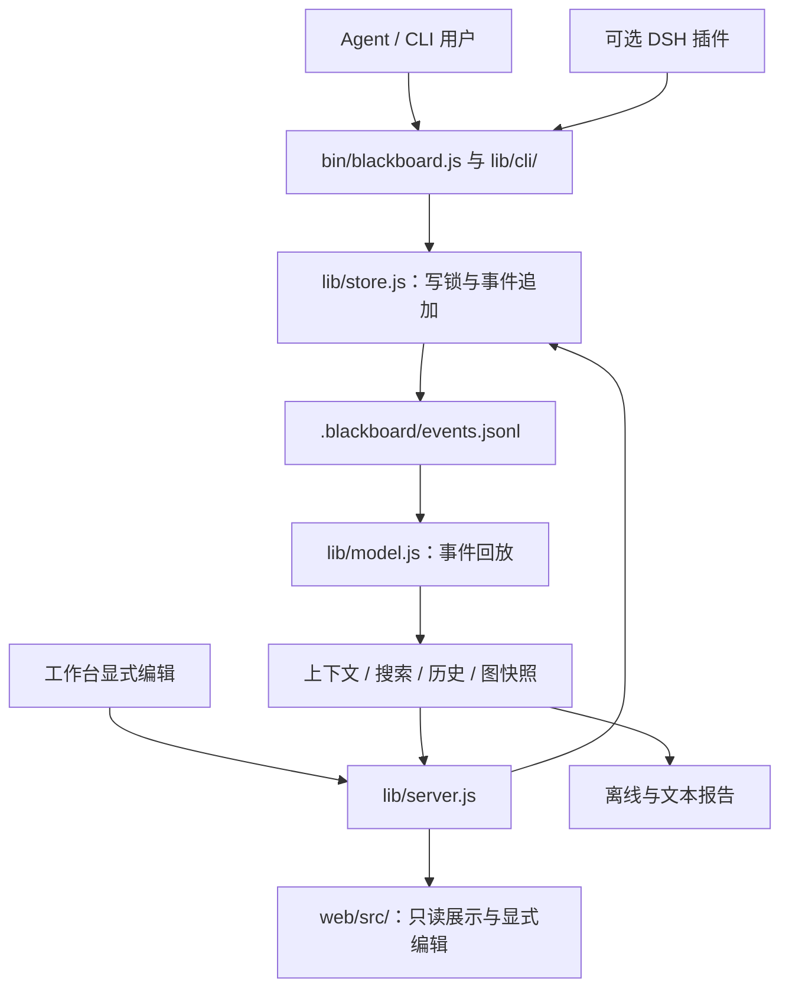

# 架构与维护边界

[文档目录](README.md) · [贡献指南](../CONTRIBUTING.md) · [工程原则](../AGENT.md) · [公开契约](CONTRACT.md)

本文描述 `0.10.1` 的源码组织：CLI 支持代码、实时与离线图快照、实时推送与前端订阅、存储文件 I/O、HTTP 写入、批量写入和版本包发布各有明确边界，开发验证脚本复用公共辅助实现。模块路径是实现细节，宿主与脚本依赖的稳定接口只由[公开契约](CONTRACT.md)定义。

## 数据如何流动

事件日志是唯一事实源。`state.json` 是可丢弃缓存；上下文包、图快照、历史、Digest 与导出都是投影。读取视角、布局、搜索和 URL 恢复不产生事件，也不替 Agent 选择下一步。节点与关系只在明确请求时写入，所有写入经过 store 的同一把事件写锁。

## 目录与责任

| 位置 | 维护职责与依赖边界 |
| --- | --- |
| `bin/blackboard.js` | 唯一 CLI 入口；组装命令、调用领域模块、处理进程错误与退出状态 |
| `lib/cli/args.js` | CLI 参数解析与选项约束 |
| `lib/cli/help.js` | CLI 帮助文本 |
| `lib/cli/format.js` | 终端颜色与人类可读的行格式；不决定 JSON schema |
| `lib/contracts.js` | 纯常量：`OUTPUTS`、`WRITE_TARGETS`、`GRAPH_SCHEMA`；CLI 与投影共用，保持浏览器可用 |
| `lib/model.js`、`lib/semantics.js` | CLI、服务、浏览器共用的回放与语义；不引入 Node-only API |
| `lib/store.js` | 项目板发现、事件追加、缓存、游标与检查点；在写锁内校验事件版本，不认识宿主。单条写入与 `writeBatch` 共用同一套节点、关系、修改的执行函数，batch 只在内存工作图上逐行执行后整体提交 |
| `lib/batch.js` | `batch` 的 JSONL 解析：字段白名单、类型与批内引用检查，错误带输入行号；不写事件 |
| `lib/storage/` | `file-lock.js` 管理跨进程锁、文件身份核对与异常清理；`event-file.js` 管理完整字节读取、短读和断尾修复；不决定事件语义 |
| `lib/context.js`、`lib/digest.js`、`lib/search.js`、`lib/history.js`、`lib/lint.js` | 由已记录的内容生成上下文、摘要、查询、追溯与提示；省略明确报告，不推断缺省维度 |
| `lib/snapshot.js` | Node 运行时中的 `buildGraphSnapshot`；实时 HTTP / SSE 与离线 HTML 共用图、身份与有效焦点投影，通过选项保留各自的可写性和活动详情边界 |
| `lib/server.js`、`lib/service.js` | loopback HTTP / SSE、读取路由、静态资产、服务端口与身份探测 |
| `lib/http/` | `request.js` 统一请求防护、JSON body 与错误响应；`write.js` 处理显式写入、署名、冲突与回执；`graph-stream.js` 只在有订阅者时轮询日志并推送完整快照，慢连接按 `drain` 只保留最新一份待发快照；均不管理服务生命周期 |
| `lib/export*.js` | 离线 HTML、文本报告、筛选数据与格式序列化；不新增事实源 |
| `lib/backup.js`、`lib/receipts.js` | 可校验备份恢复、从事件投影的写入回执 |
| `lib/setup.js`、`lib/hooks.js`、`lib/release.js` | 接入安装、可选 Claude Hook、稳定版本与 current 切换；开发仓库不直接替代日常安装 |
| `lib/release/` | `publication.js` 复制包文件、发布版本目录与 current 链接；强制替换失败时恢复原版本，回滚或清理失败时保留旧字节并报告恢复路径 |
| `skills/blackboard/` | 完整 Skill 的唯一发布源：入口、参考、方法、图标和宿主展示元信息一起分发 |
| `web/src/` | React 工作台，读取 API / SSE 或离线快照，保留显式编辑、冲突草稿和 Agent 阅读视角 |
| `public/` | Vite 从 `web/` 生成的分发资产，随根包提供给服务与离线导出 |
| `plugins/dsh-blackboard/` | 独立依赖、版本与测试的可选宿主适配；根包不导入插件或 Host SDK |
| `scripts/`、`scripts/lib/` | 开发与验证入口；`environment.mjs` 隔离子进程的 BLACKBOARD 环境，`sarif-validator.mjs` 共用官方 SARIF schema 校验；不是运行时依赖，不能从 `lib/` / `bin/` 反向导入 |
| `test/`、`test/fixtures/` | 根包行为测试、公开契约固定输出、合成事件与官方校验 schema；不进入运行时包 |

新功能按数据责任放进已有层。不要为内部模块改名保留转发文件；迁移所有内部调用方。公开接口需要兼容，内部实现路径不需要成为宿主依赖。

## 实时与离线快照

`lib/snapshot.js` 的内部入口为 `buildGraphSnapshot(cwd, { writable = false, includeActivityDetails = true } = {})`。它读取 store，统一节点投影、统计、各 Agent 摘要与焦点；依赖 Node 文件存储，不是浏览器共享模块，也不是供插件依赖的公开 API。

焦点只接受图中仍存在的节点：先取有效的事件元数据焦点，再取有效的缓存焦点，否则输出 null。`0.8.1` 修复了此前缓存 `focus` 指向不存在节点时，实时输出 null、离线 HTML 却保留失效 ID 的差异；有效节点与 Agent 身份的读取语义保持一致。

离线 HTML 仍传入 `includeActivityDetails: false`，活动只保留 `id`、`tool`、`status`、`at`、`linkedNodeIds`，不带原始 `input` / `output` / `summary`，也不序列化 `meta.writable`。共享组装函数不表示把实时活动材料或页面写权限带入分享文件。相关行为由实际 HTTP 响应与 HTML 导出回归约束；是否已执行仍看本轮验证记录。

## 前端如何分工

`web/src/App.tsx` 负责 UI 组装、画布布局、拖动节点身份缓存和键盘交互；等待快照后恢复深链、清除已删除节点的选择仍留在 App，因为这些行为依赖投影与待布局焦点。工作台自己的派生数据与 URL 状态放在 `web/src/workspace/`：

- `selectors.ts`：纯快照索引、侧栏分组与筛选统计、Agent 阅读视角。
- `use-workspace-data.ts`：派生数据和画布投影的 React memo 边界。
- `use-workspace-location.ts`：读取 URL 初始值，并同步 Agent / view / node 地址；不承担依赖快照的节点选择与布局恢复。
- `graph-stream.ts`：实时订阅控制器，管理 `/api/graph` 读取、`/events` 流、按请求开始排序和释放时中止请求；只接受顶层结构有效的图快照，无效数据保留上一份快照并显示离线，连接建立本身不算已同步。`use-graph-stream.ts` 只把它接入 React 状态。

现有 `graph.ts` 负责图投影，`presentation.ts` 负责记录的显示语义，`api.ts` 负责写请求，`panels/` 负责面板。浏览器共享模型不得通过新的间接 import 引入文件系统、进程或开发脚本。界面风格见[界面规范](../design/UI_SYSTEM.md)。

切换 Agent 只切换阅读视角。写请求仍由用户明确发起，只提交实际变更字段和对应基准；冲突保留草稿。实时工作台与离线 HTML 使用相同的图 schema 和身份语义，离线页面保留上述字段裁减，也不访问远端历史接口。

## 适配与发布边界

DSH 的 CLI 桥每次显式传 `--cwd`、`--agent`，写入另加 `--no-init`；兼容性和写入目标读取 `capabilities`。它不依赖内核的锁或缓存文件名。完整 Skill 仍按发布包结构从 CLI 包的 `skills/blackboard/` 定位，这一处不是公开 CLI 契约；详见[插件说明](../plugins/dsh-blackboard/README.md)。

根 npm 包按 `package.json.files` 分发 `bin/`、`lib/`、`skills/`、`public/` 与首页，零运行时依赖。前端及导出消费端验证依赖均为开发依赖；安装后的 Node 18 CLI 使用已构建产物。插件有自己的 npm 包和更高的宿主 Node 要求，根包安装不应拉入 Host SDK。

日常启动器、Skill、Hook 与常驻服务指向独立安装的 `current`。开发时只写独立合成演示板；[本地启动与验证](../CONTRIBUTING.md#local-development)列出实际命令。

开发验证子进程通过 `scripts/lib/environment.mjs` 的 `isolatedBlackboardEnv` 去掉继承的全部 `BLACKBOARD_*`，再显式加入该次验证的覆盖值，避免误选真实项目。`scripts/lib/sarif-validator.mjs` 读取测试目录中的固定 OASIS schema，以 Ajv 校验真实导出结果；Ajv、schema fixture 与这两个脚本都留在开发边界，运行时 SARIF 导出不依赖它们。

## 改动在哪里验证

| 变更范围 | 主要行为证据 |
| --- | --- |
| CLI 参数、输出与 schema | `test/blackboard.test.js`、`test/contract-output.test.js`、`test/write-contract.test.js`、`test/node-json.test.js`；固定输出与 capabilities 同步 |
| 批量写入 | `test/batch.test.js`：批内引用与作者、不移动游标、任一行出错整批不写、request-id 重试与中途中断后的补齐、上限与截断 |
| 事件、写锁、身份、恢复 | `test/store-io.test.js` 的异常、短读与所有权回归，及 `test/recovery.test.js`、`test/receipts.test.js`、`test/backup.test.js`、`test/iteration.test.js` |
| 上下文预算与历史 | `test/context-*.test.js`、`test/history.test.js`；`npm run evaluate:recovery` 验证合成投影，不替代真实模型恢复试验 |
| 服务写入、历史与回执 | `test/api-receipts.test.js`、`test/input-integrity-api.test.js`；可选 `npm run verify:api` 需要 Postman CLI |
| 视角、筛选、显示与图布局 | `test/frontend.test.js`、`test/canvas.test.js`、`test/web-completeness.test.js`；纯模块测试不等于完整浏览器交互验收 |
| 实时 / 离线图快照一致性 | `test/snapshot.test.js`：通过真实 HTTP 与导出的 HTML 检查失效缓存焦点处理，并保留离线活动详情与可写标记的裁减边界 |
| 实时推送与订阅 | `test/graph-stream-delivery.test.js` 覆盖慢连接合并、空闲后加入和已断开读者；`test/graph-stream.test.js` 覆盖前端排序、无效快照保留、释放中止和离线导出不发请求 |
| HTML、Markdown、Mermaid、SARIF | `test/export*.test.js`，再用 `npm run verify:exports` 做 Chromium 消费端与官方 SARIF schema 验证 |
| 包边界、版本发布与 Node 运行时 | `test/packaging.test.js`、`test/release.test.js` 的发布失败回滚与清理、`npm run verify:package`；真实 tarball 的干净消费者安装 |
| Skill、可选方法、公开内容 | `test/skill.test.js`、`test/methods.test.js`、`test/publication.test.js`、`npm run check:publish` |
| 文档路径、图片与锚点 | `test/docs.test.js`、`npm run check:docs`；本地解析公开 Markdown，不探测外部站点 |
| DSH 插件 | 插件自己的 `test/` 与 `npm run check`；真实 Host、设置页、profile 与模型检查按[插件文档](../plugins/dsh-blackboard/README.md#测试)分别执行 |

这些是验证入口与职责，不是本次执行记录。跨平台与运行时矩阵的覆盖、实际命令和未覆盖环境见 [CI 说明](ci.md)；性能测量见[性能基线](performance.md)。
